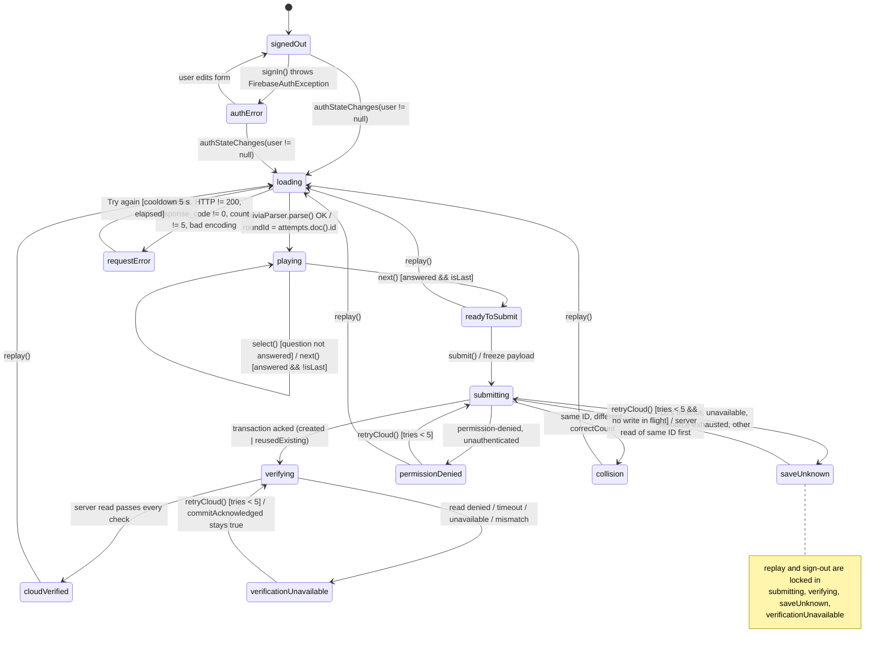

# Science Signal state machine

Names match `Phase` in `lib/state/quiz_controller.dart`.

Any transition into `signedOut` (or a different user's `loading`) bumps `_generation`. A cloud call that comes back under an old generation, UID or round ID is ignored (`stale()` in `_runCloud`).
